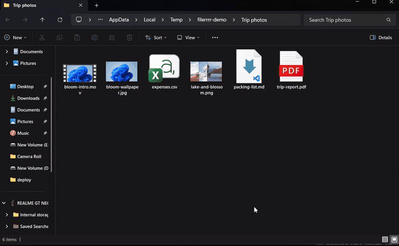
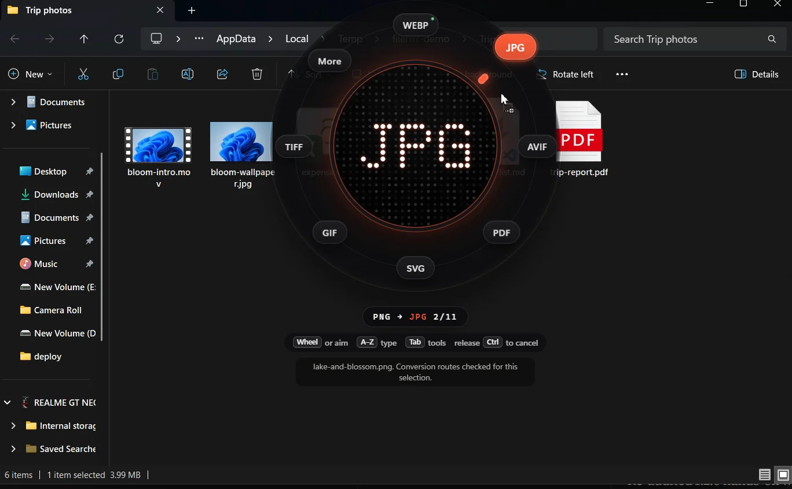
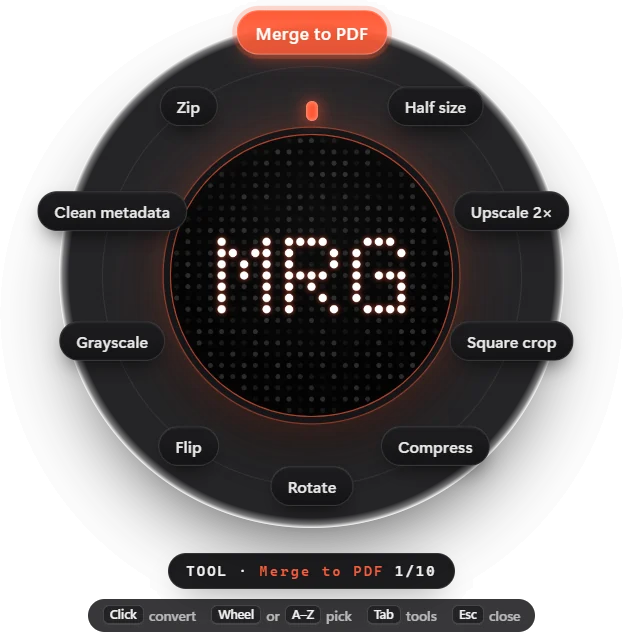
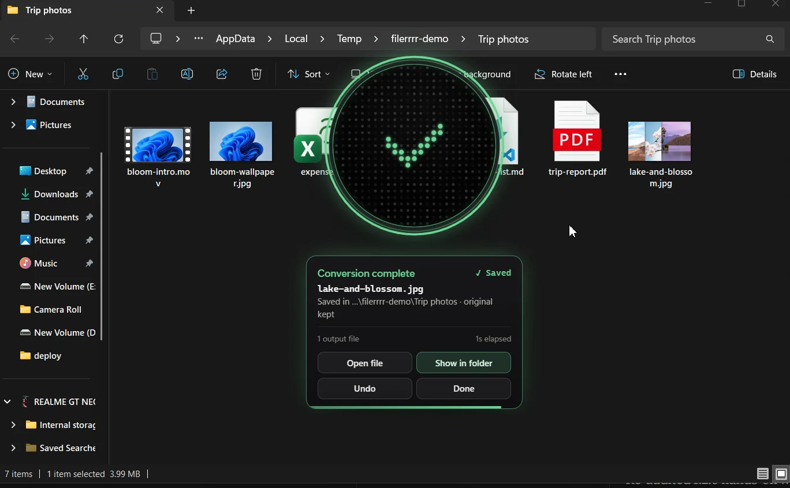
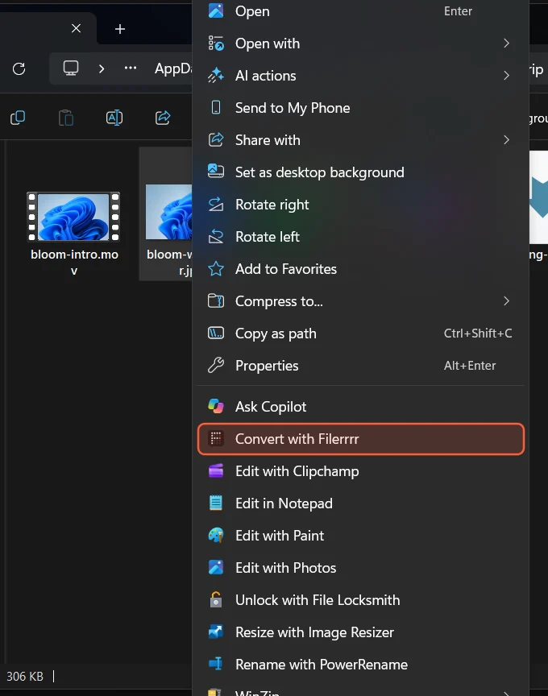
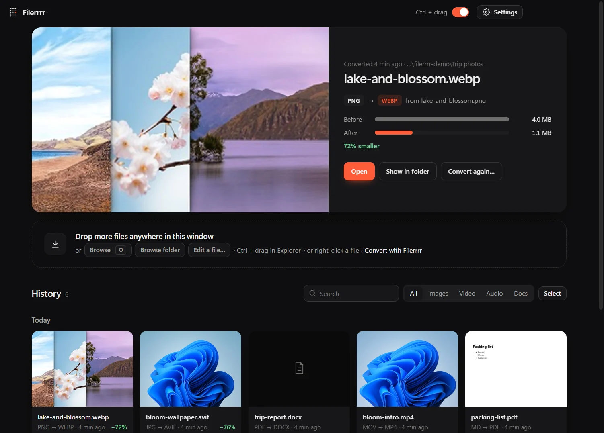
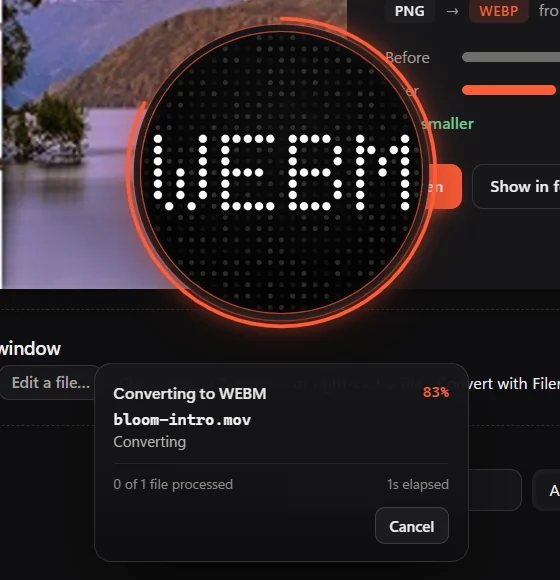
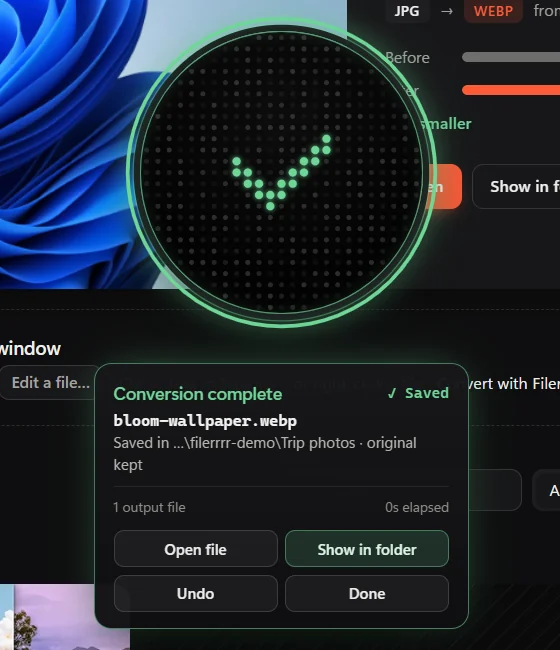
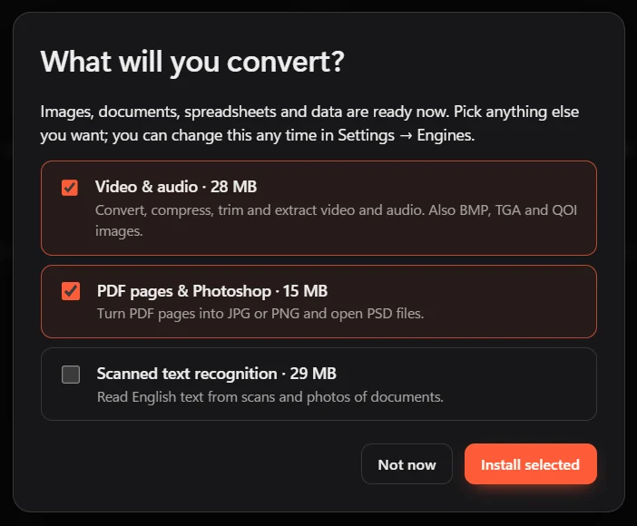

<p align="center"></p>

<h1 align="center">Filerrrr</h1>

<p align="center"><b>Convert files right where they are.</b><br>Hold <kbd>Ctrl</kbd>, drag a file in File Explorer, pick a format. Converted on your PC, nothing uploaded.</p>

<p align="center">
  <a href="https://github.com/Aaad1tyaaA/filerrrr-releases/releases/latest"><b>Download for Windows</b></a> ·
  <a href="https://aaad1tyaaa.github.io/filerrrr/">Website</a> ·
  <a href="https://github.com/Aaad1tyaaA/filerrrr/issues">Report a problem</a>
</p>

<p align="center"></p>

## How it works

| 1. Hold Ctrl and drag | 2. Aim at a format, or Tab for tools | 3. Let go: saved next to the original |
|---|---|---|
|  |  |  |

While the palette is open: <kbd>Wheel</kbd> steps through formats, <kbd>A</kbd>–<kbd>Z</kbd> jumps to one (type `pd` for PDF), <kbd>Tab</kbd> flips to tools, and letting go of <kbd>Ctrl</kbd> cancels.

**Or right-click** any file → **Convert with Filerrrr** (top of the Windows 11 menu, and in Send to).



## The app



| Converting | Done | Optional engines |
|---|---|---|
|  |  |  |

- **Formats:** images (JPG, PNG, WEBP, AVIF, HEIC, GIF, TIFF, SVG, ICO, PSD), PDF ↔ Word/Markdown/HTML/text, spreadsheets and data (XLSX, CSV, JSON, YAML, TOML, XML), archives, fonts, video and audio
- **Best quality by default:** lossless WEBP from screenshots, full-colour JPG, 320 kbps audio, 300 dpi PDF pages
- **Safe:** originals are never changed; Undo sends results to the Recycle Bin; the result card says where the file went
- **Optional engines** (video & audio, PDF pages & Photoshop, scanned-text recognition) download only if you want them, from their official sources, checked by SHA256. An FFmpeg already on your PATH is used instead.
- **Presets, watch folders**, crop / trim / PDF-page editors, batch conversion with cancel
- **Private:** works offline, no account, no telemetry

Windows 10/11 x64. The installer is not code-signed, so Windows may show an "unknown publisher" warning (More info → Run anyway).

## Build from source

Windows x64 with Node.js 22+, Visual Studio C++ Build Tools and the Windows SDK.

```powershell
npm ci
npm run native      # drop-target DLL
npm run menu        # Windows 11 Explorer menu DLL and package
npm start
```

Tests and packaging:

```powershell
npm test                 # Node tests
npm run test:electron    # Electron checks
npm run test:e2e         # real Ctrl+drag from Explorer (moves the mouse for ~2 minutes)
npm run dist             # Setup, portable ZIP and engine manifest in release/
```

See [RELEASE.md](RELEASE.md) for how engines are pinned and verified. Third-party notices are in `THIRD-PARTY-NOTICES.txt`.

## Licence

[MIT](LICENSE)
